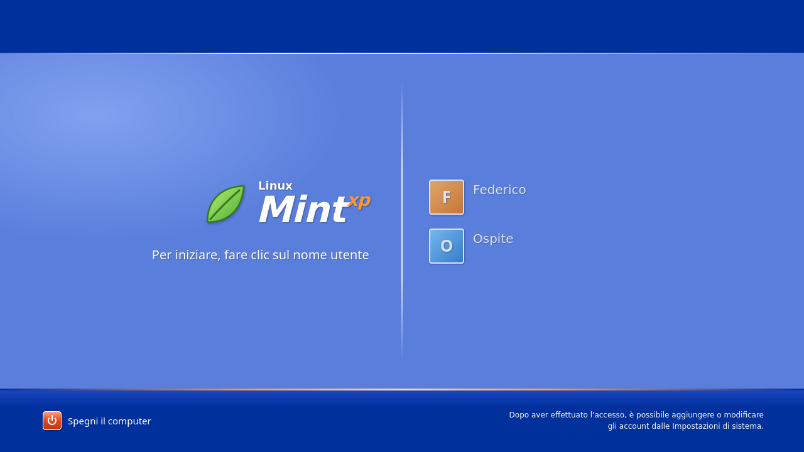

# XP Mint

Un tema di login in stile Windows XP per **Linux Mint**, pensato per [nody-greeter](https://github.com/JezerM/nody-greeter) (il greeter web di LightDM). Sostituisce la schermata di accesso di Mint con una ispirata a quella di XP: barre blu in alto e in basso, elenco utenti con avatar colorati e logo "Linux Mint xp".



## Requisiti

- Linux Mint con LightDM
- `nody-greeter` (o `web-greeter`) installato. Se manca, scarica il `.deb` dalle [release](https://github.com/JezerM/nody-greeter/releases) e installalo:

  ```bash
  sudo apt install ./nody-greeter_*.deb
  ```

## Installazione

```bash
git clone <url-del-repository> xp-login
cd xp-login
sudo ./installa.sh
```

Lo script:

1. copia il tema in `/usr/share/web-greeter/themes/xp-mint`;
2. imposta `theme: xp-mint` in `/etc/lightdm/web-greeter.yml` (salvando una copia in `web-greeter.yml.bak`);
3. crea `/etc/lightdm/lightdm.conf.d/99-xp-mint.conf` per far usare a LightDM il greeter web.

Esci dalla sessione o riavvia per vedere la nuova schermata.

## Ripristino

Se qualcosa va storto, passa a una console con `Ctrl+Alt+F2`, accedi e lancia:

```bash
sudo ./installa.sh --ripristina
```

Al prossimo avvio tornerà la schermata di login originale di Mint.

## Anteprima nel browser

Il tema è HTML/CSS/JS puro. Il file `xp-mint/mock.js` simula l'oggetto `lightdm` quando la pagina è servita via HTTP, quindi puoi provarlo senza installare nulla:

```bash
cd xp-mint
python3 -m http.server 8000
```

Poi apri <http://localhost:8000>. Dentro il greeter vero `mock.js` non fa nulla.

## Struttura

```
installa.sh        script di installazione / ripristino
xp-mint/
  index.html       struttura della pagina
  index.yml        metadati del tema (pagina principale)
  style.css        stile
  script.js        logica di login
  mock.js          finto oggetto lightdm per l'anteprima
```

## Alternative

Esiste anche [WelcomeXP](https://github.com/mshernandez5/WelcomeXP) di mshernandez5, un altro tema in stile XP per nody-greeter e web-greeter. L'ho scoperto solo dopo aver pubblicato questo progetto: è nato in modo indipendente.

## Licenza

Distribuito con licenza [GNU GPL v3](LICENSE) o successiva.
